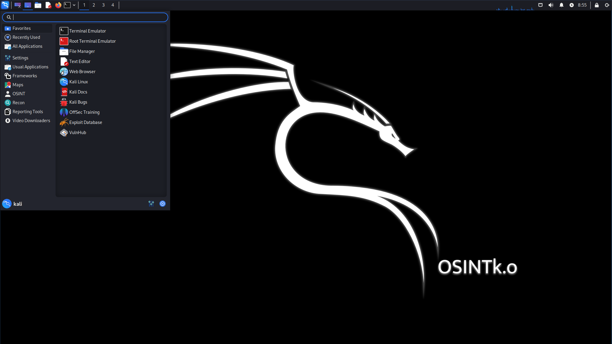

# OSINTk.o - A Kali Linux based VM image for OSINT investigations




# The Project

OSINTk.o is a customized Kali Linux-based virtual machine image with pre-installed packages and scripts. The idea behind this project is to combine a portion of Kali Linux tools and some OSINT scripts that are freely available on GitHub.

I started OSINTk.o as an educational and fun project to dive deeply into Kali Linux. My idea was to create a VM with some Kali generic tools and pre-installed OSINT scripts. I learned a lot, and although it may not seem like it at first glance, configuring XFCE menus and correctly placing Python scripts and their dependencies has its challenges when embedding them in a VM image.
However, I am not the one that got this idea first. I was inspired by [Trace Labs VM](https://github.com/tracelabs/tlosint-live) and [CyberPunkOS](https://github.com/cyberpunkOS/CyberPunkOS).

The image is built with [debos](https://github.com/go-debos/debos) from a declarative recipe and assembled on GitHub Actions, producing a ready-to-use `qcow2` disk image for both Intel and Apple Silicon Macs, plus a `vdi` image (amd64 only) for VirtualBox on Windows/Linux.

> An older `live-build`-based ISO of this project is still available on [my personal website](https://yordanova.info/kali-linux-osintko-amd64.iso), but it's no longer maintained and will likely throw errors today - several of the vendored tools it bundled have since broken (unpinned dependencies, upstream API changes, abandoned repos). Use the images described below instead.

> **`qcow2` is built and tested on UTM (macOS, Intel or Apple Silicon) only.** The `vdi` build is produced for VirtualBox (Windows/Linux/macOS) but hasn't been boot-tested the way the UTM path has this session - treat it as less proven for now. ARM64 doesn't get a `vdi` at all, since VirtualBox doesn't meaningfully support arm64 guests.

## How the recipe works

Unlike the older `live-build`-based Kali remasters (including an earlier version of this project), debos recipes are plain YAML: each `action` bootstraps, installs, or post-processes the image in order, instead of a maze of chroot hooks. The repo is organized as:

* `debos/osintko-amd64.yaml` / `debos/osintko-arm64.yaml` - the two recipes. Each bootstraps `kali-rolling`, installs the apt package list, runs the scripts below, partitions the disk, installs GRUB, and exports a `qcow2`.
* `debos/scripts/` - shell scripts run inside the chroot at specific recipe steps:
  * `install-vendored-tools.sh` - installs the OSINT tools that don't have a Kali package (pip where possible, otherwise a fresh git clone), with per-tool patches for upstream bugs found during testing
  * `configure-initramfs.sh` - trims the initrd to VM-only storage drivers
  * `cleanup.sh` - purges orphaned packages and clears apt/machine-id state before export
  * `zero-free-space.sh` / `export-qcow2.sh` - zero free blocks and convert the raw image to a compressed `qcow2` (and, for amd64, a `vdi` for VirtualBox)
* `debos/overlays/osint-menu/` - the custom XFCE menu (replaces Kali's stock category layout - see below) and the vendored tools' `.desktop` launchers/icons
* `debos/overlays/branding/` - wallpaper and default XFCE desktop settings
* `debos/Dockerfile.arm64` - the arm64 recipe builds inside this container, since GitHub's arm64 runners don't expose `/dev/kvm` and debos needs a privileged environment to partition/mount the image

### The menu

Kali's own menu (`kali-menu` package) now follows a MITRE ATT&CK category scheme (Reconnaissance, Discovery, Command and Control, ...). OSINTk.o replaces that file entirely with its own layout - Usual Applications / Recon / Maps / OSINT / Video Downloaders / Frameworks / Reporting Tools - with OSINT further split into username/email/social-media/phone-number. `kali-menu` is held (`apt-mark hold`) in the built image so a routine `apt upgrade` can't silently revert it.

### CI

`.github/workflows/build-debos.yml` builds both architectures in parallel on every push touching `debos/**`: amd64 natively on an Ubuntu runner, arm64 inside the Dockerfile above on GitHub's arm64 runner (no KVM, so the recipe runs unaccelerated). The arm64 job additionally boots the resulting `qcow2` in plain QEMU as a smoke test before uploading it.

## Building it yourself

**amd64**, with `debos` and `qemu-utils` installed:
```bash
mkdir -p images
sudo debos \
  --memory=4G \
  --scratchsize=40G \
  --artifactdir=images \
  -t hostname:osintko \
  -t imagename:osintko-amd64 \
  -t username:osintko \
  -t password:osintko \
  debos/osintko-amd64.yaml
```

**arm64**, via the provided Docker builder (needed for the privileged mount/partition steps):
```bash
docker build -t osintko-arm64-builder -f debos/Dockerfile.arm64 .
docker run --rm --privileged --net host --tmpfs /run --tmpfs /tmp \
  --volume /dev:/dev --volume "$(pwd):/recipes" --workdir /recipes \
  osintko-arm64-builder \
  debos --memory=4G --scratchsize=8G --artifactdir=images \
    -t hostname:osintko -t imagename:osintko-arm64 \
    -t username:osintko -t password:osintko \
    debos/osintko-arm64.yaml
```

The amd64 command additionally produces `images/osintko-amd64.vdi`; both commands produce `images/osintko-<arch>.qcow2`.

# Requirements

- **UTM** (macOS, Intel or Apple Silicon): use the `qcow2` image. It's around 3.6GB to download; attach it to a UTM VM with at least 4GB of RAM. The virtual disk is pre-sized at 20GB but thin-provisioned, so it won't actually use that much space on your Mac unless the VM grows into it.
- **VirtualBox** (Windows/Linux/macOS, amd64 only): use the `vdi` image. VDI doesn't support qcow2-style compression, so expect a larger download than the qcow2.

Default login: `osintko` / `osintko`.

# Download

The built images are hosted on [my personal website](https://yordanova.info):

- Intel/AMD64, UTM: `kali-linux-osintko-amd64.qcow2`
- Apple Silicon/ARM64, UTM: `kali-linux-osintko-arm64.qcow2`
- Intel/AMD64, VirtualBox: `kali-linux-osintko-amd64.vdi`

If you'd rather build it yourself, every push to this repo triggers a GitHub Actions build for both architectures - check the [Actions tab](https://github.com/LinaYorda/OSINTko/actions) for the latest run and download the artifact directly.

# Tools and Programs included

## Frameworks

- [Maltego](https://www.maltego.com/)
- [Nmap](https://nmap.org/download.html)
- [Recon-ng](https://github.com/lanmaster53/recon-ng)
- [Spiderfoot](https://github.com/smicallef/spiderfoot)
- [Tcpdump](https://github.com/the-tcpdump-group/tcpdump)
- [theHarvester](https://github.com/laramies/theHarvester)
- [Wireshark](https://github.com/wireshark/wireshark)
- [sn0int](https://github.com/kpcyrd/sn0int)
- [Subfinder](https://github.com/projectdiscovery/subfinder)

## Maps

- [Marble](https://marble.kde.org/install.php)
- [Gnome-Maps](https://download.gnome.org/sources/gnome-maps/45/)

## OSINT

### Username

- [Sherlock](https://github.com/sherlock-project/sherlock)
- [Blackbird](https://github.com/antoniaci/blackbird)
- [Maigret](https://github.com/soxoj/maigret)
- [Linkook](https://github.com/JackJuly/linkook)
- [Osgint](https://github.com/hippiiee/osgint)
- [Socialscan](https://github.com/iojw/socialscan)
- [Near](https://github.com/SamueleAmato/Near)

### Email

- [Holehe](https://github.com/megadose/holehe)
- [Mailaccess](https://github.com/KatrielMoses/MailAccess)
- [Zehef](https://github.com/N0rz3/Zehef)
- [GHunt](https://github.com/mxrch/GHunt)

### Social Media

- [Aliens Eye](https://github.com/arxhr007/Aliens_eye)
- [Instaloader](https://github.com/instaloader/instaloader)
- [Social-Analyzer](https://github.com/qeeqbox/social-analyzer)

### Phone number

- [X-osint](https://github.com/TermuxHackz/X-osint)

## Recon

- [Amass](https://github.com/owasp-amass/amass)
- [FinalRecon](https://github.com/thewhiteh4t/FinalRecon)
- [WhatWeb](https://github.com/urbanadventurer/WhatWeb)
- [WPscan](https://github.com/wpscanteam/wpscan)

## Reporting Tools

- [CherryTree](https://github.com/giuspen/cherrytree)
- [Eyewitness](https://github.com/RedSiege/EyeWitness)
- [Joplin](https://github.com/laurent22/joplin)

## Video Downloaders

- [Yt-dlp](https://github.com/yt-dlp/yt-dlp)
- [youtubedl-gui](https://packages.debian.org/trixie/youtubedl-gui)

## Kali Linux Usual Applications
- Accessories
- Development
- Graphics
- Internet
- Multimedia
- Office
- Other
- System

# Known Issues

A few of the vendored OSINT scripts write output (logs, downloaded files) relative to their own install directory rather than your home folder. This previously caused "permission denied" errors since that directory was root-owned; it's now fixed at build time for the affected tools. If you hit a similar permission error on a tool not listed here, let me know.

# Feedback

If you have any feedback, suggestions or comments please reach out to me at schefflina@gmail.com

# Disclaimer

**Educational Purpose Only: This software is provided for educational purposes only. It is not intended for production use or any critical applications.**

By using this software, you understand and agree that:

- This software is for educational purposes and should not be used in any mission-critical or production environments.

- The software may contain errors, bugs, or vulnerabilities, and should not be relied upon for any real-world applications.

- You are solely responsible for any consequences, including but not limited to data loss, damage, or security breaches, that may occur as a result of using this software.

- The authors and contributors of this software are not responsible for any damages or losses, direct or indirect, that may result from the use of this software.

Please use this software responsibly and with the understanding that it is for educational purposes only. If you require a production-ready solution, it is recommended to seek professional software or services.

**You use this software at your own risk.**
